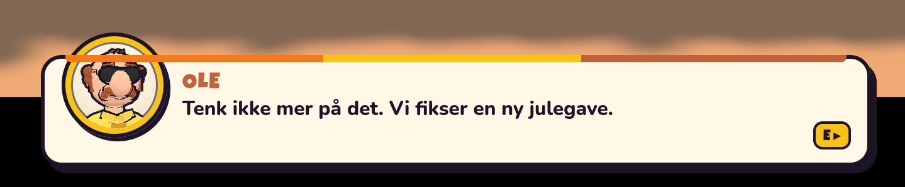

# Snackrutorna buggar ur – gör dem högre (bugg)

**Implementerat.** Det gällde dialogrutan (`#dialog`: porträtt, namn, repliken och E ▸), som byggs i
`hud.runDialog` (`src/game/hud.js`) med stilen i `style.css`.

- **Vad som var fel:** Rutan hade ingen egen höjd. Den följde den text som hunnit skrivas ut, med
  plats för två rader. När skrivmaskinstexten bröts till en tredje rad växte rutan uppåt mitt i
  repliken, från 118 till 145 px vid 1280×720, och porträttet hoppade med. Nästa korta replik
  krympte den igen. Dessutom stack porträttet 42 px upp över rutans överkant (`margin-top: -42px`),
  och den randiga listen i överkanten ritades tvärs över ansiktet. Det är det som syns i bilden.
- **Vad jag ändrade:** Porträttet sitter nu inne i rutan, under listen. Textytan är minst tre rader
  hög, så rutan är 152 px i stället för 118 (plus den del av porträttet som stack ut). En replik på
  en till tre rader ger samma ruta. Grundorsaken är löst i `runDialog`: den del av repliken som inte
  är utskriven än ligger i `data-rest` och läggs ut osynligt av `.dlg-text::after`. Då har rutan
  hela replikens höjd redan vid första bokstaven, oavsett längd. Den växer aldrig mitt i en replik,
  och inget ord hoppar ner till nästa rad medan det skrivs. `.dlg-text` har `overflow-wrap:
  anywhere`, så inte ens ett ord utan brytpunkter kan sticka ut åt sidan. `.dlg-text`s
  `textContent` är fortfarande bara den utskrivna delen, så testerna som läser den fungerar som
  förut. Kontraktet står i DESIGN §14.8 (`hud.runDialog`), scenariot i §16.4, plus en rad i
  changeloggen.
- **Verifiering:** Headless på port 8861, ett scenario i taget. Det nya scenariot `snackrutor`
  (`tools/scenarios/meter.mjs`) letar upp den längsta repliken i `src/content` och `src/game`. Det
  är Lasses ed i friskotek-uppdraget, 138 tecken. Scenariot visar den i dialogrutan, i en
  radiotoast och i en pratbubbla. För dialogrutan mäts höjden i varje bildruta medan repliken
  skrivs ut långsamt. Scenariot kontrollerar också att porträttet och texten ligger inne i rutan
  och att rutan syns på skärmen. För toasten och bubblan kontrolleras att texten ligger inne i dem.
  - Mot den gamla koden ger scenariot FAIL: rutan växte från 118 till 145 px mitt i repliken, och
    porträttet låg utanför.
  - Med fixen ger det PASS vid 1280×720, 960×540 och 800×600, med rutan konstant 152 px från
    första till sista bokstaven.
  - Vid 640×480 behöver repliken fem rader. Där är rutan 206 px redan vid första bokstaven, och
    texten håller sig inne.
  - Jag tittade på bilderna före och efter.
  - `ui` och `talk` ger PASS. Ole, Stig och flygplatsscenen med letterbox ser rätt ut.
  - `story` och `fullstory` ger båda `#13 idle`, `no errors` och `RESULT: PASS`.
